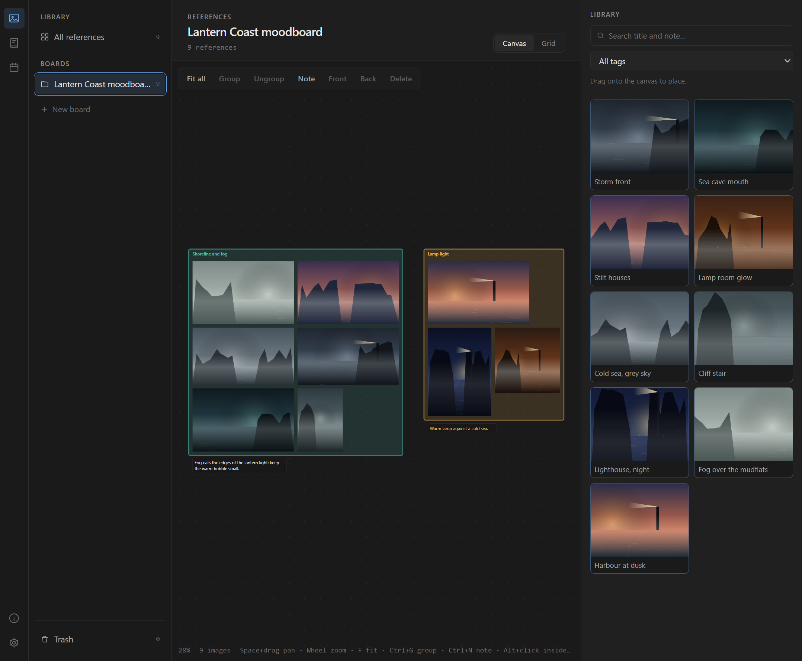
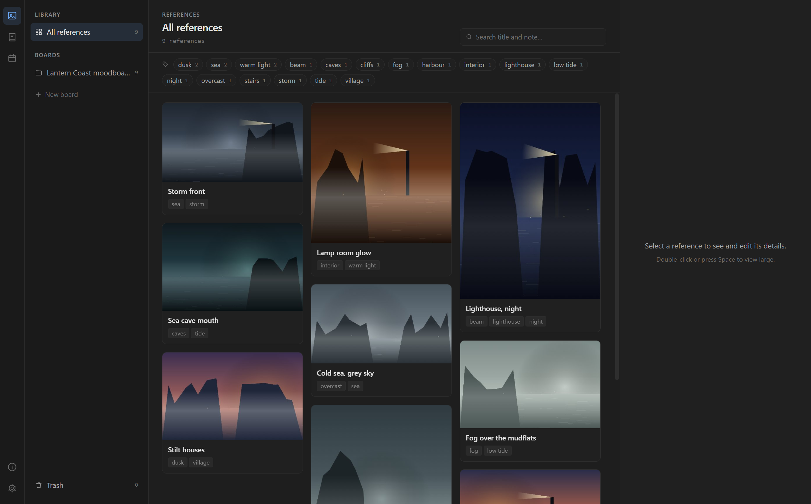
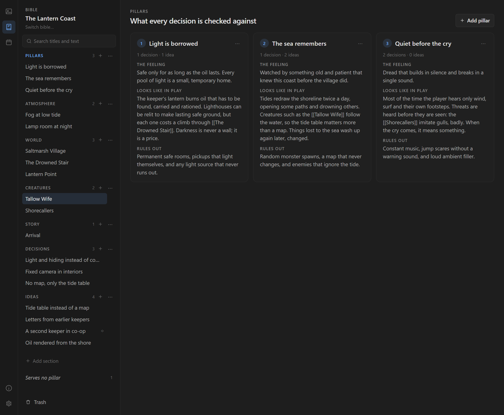
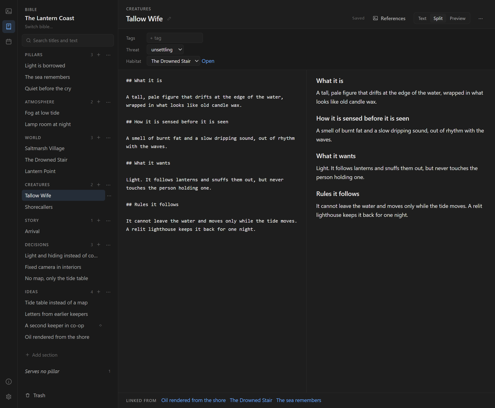

# Loam

**Grow your game from intent.**

Loam is a free, open-source desktop app for indie developers who make games creatively and artistically. It keeps your references, your game's intent and your learning in one place, as files you own.



## Download

**[Download the latest release for Windows](https://github.com/Small-Piece/loam/releases/latest)** (the file named `Loam Setup <version>.exe`).

The installer is not code-signed yet. The first time you run it, Windows SmartScreen may say "Windows protected your PC". Choose **More info**, then **Run anyway**. Each release lists the installer's SHA-256 checksum, so you can check the file you downloaded:

```powershell
Get-FileHash "Loam Setup 0.1.0.exe" -Algorithm SHA256
```

Loam runs on Windows 10 and 11 (64-bit).

## Your work stays yours

- **Local-first.** Your library lives on your computer, in `%LOCALAPPDATA%\Loam`. Bibles and journals are plain Markdown folders wherever you put them: open them in any editor, keep them in git, share them with a teammate.
- **No telemetry.** No accounts, no analytics, nothing about you or your work is sent anywhere.
- **Off by default.** The optional helpers below stay off until you turn them on, and nothing goes online unless you ask.

## What it does

- **Library.** Drop or paste images, then give them titles, notes, sources and tags. Filter by tags and search the text.
- **Boards.** Arrange references on a canvas: move, scale and layer them, group them and add notes. Or view a board as a grid.
- **Creative bible.** Write down what your game is meant to be: design pillars, the world, creatures, characters and story, with fields per section and `[[links]]` between entries. Start from a kit (blank, action roguelike, atmospheric horror, cozy sim or narrative adventure), or open the original sample bible, "The Lantern Coast".
- **Decisions and ideas.** A decision log that names the pillars each decision serves, a timeline, an idea parking lot you can promote from, and a list of anything that serves no pillar.
- **Study journal.** Practice sessions, topics, a calendar and side-by-side comparison of your work over time. No streaks, no guilt.
- **Optional helpers.** Tag suggestions and study recaps from a small model that runs on your computer, off by default. Nothing is applied without your click.

### Screenshots

The Library, with tags as filters:



The pillars of the sample bible, "The Lantern Coast":



A creature entry, with its fields and the entries that link to it:



The reference images in these screenshots were drawn by a script for this purpose; the bible is the sample that ships with Loam.

Why Loam exists, and the principles behind it: [docs/why.md](docs/why.md).

## Build from source

You need [Node.js](https://nodejs.org/) 24 or newer and pnpm (`corepack enable` sets up the version this repository asks for).

```powershell
pnpm install
pnpm dev            # run the app from source
pnpm test:unit      # unit tests
pnpm build:app      # build once, then
pnpm test:e2e       # end-to-end tests against that build
pnpm build          # the Windows installer, in apps/desktop/release/
```

`pnpm lint`, `pnpm typecheck` and `pnpm format:check` run the same checks as CI.

## Contributing

Bug reports, ideas and starter kits are welcome. See [CONTRIBUTING.md](CONTRIBUTING.md). To report a security problem, see [SECURITY.md](SECURITY.md).

## License

Loam is released under the [MIT License](LICENSE). The open-source software it includes is listed, with licenses, in [THIRD_PARTY_NOTICES.md](THIRD_PARTY_NOTICES.md) and in the app under About.

## About

Loam is made by a solo indie developer, as a tool for their own game first and then for anyone it helps. Development used AI-assisted coding tools; every design decision and release is made and tested by the maintainer.
